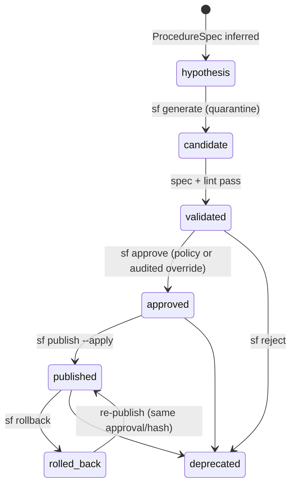

# Architecture

## Data flow and evidence lineage

```mermaid
flowchart LR
  B[experience-bundle.v1<br/>or JSONL] -->|schema + ref integrity| S[sanitise<br/>limits · secret fields · regex · injection]
  S --> Q{qualify}
  Q -->|verified| X[(SQLite<br/>experiences)]
  Q -->|recorded / self_reported| X
  X -->|same tx| O[(index_outbox)]
  O -->|sync / rebuild| I[(Qdrant<br/>dense + BM25)]
  X --> L[lineage + split<br/>held-out excluded]
  I --> C[hybrid kNN → constraints →<br/>complete linkage → cohesion/contradictions]
  L --> C
  C --> P[ProcedureSpec<br/>steps ← support ids]
  P --> Y[SkillSynthesizer<br/>template · anthropic]
  Y --> K[quarantine package<br/>+ immutable manifest + blobs]
  K --> V[spec validation · lint · leakage]
  V --> A[applicability eval]
  A --> E[paired capability eval<br/>fake · mock · live]
  E --> R[review / approve<br/>hash-bound, policy, override audit]
  R --> U[publish: dry-run → journaled install]
  U --> F[feedback attributed by package hash]
  F --> P
  U --> RB[rollback: exact snapshot]
```



Lineage is queryable end to end. `sf lineage name@ver` walks
`version → spec → steps → experiences → evidence items → source event ids`, plus
evaluations, reviews and installations.

## Lifecycle



Status dimensions are stored *separately* from the lifecycle state: `spec_compliance`,
`lint_status`, `applicability_status`, `capability_status`, `evidence_strength`,
`review_items`, `overridden`.

## Modules (`src/skill_foundry/`)

| module | responsibility |
|---|---|
| `domain/` | Pydantic domain models, lifecycle state machine, promotion policy (no persistence) |
| `contracts/` | experience-bundle.v1 validation, referential integrity, conversion, export |
| `ingest/` | limits, sanitisation, injection screening, trust qualification, labels, pipeline, hubris task import |
| `registry/` | SQLAlchemy ORM (separate from domain), Alembic migrations, repositories |
| `retrieval/` | `EmbeddingProvider` (hashing, FastEmbed), BM25 encoder, Qdrant index + outbox |
| `mining/` | features, lineage/independence/split, constrained complete-linkage discovery |
| `procedure/` | ProcedureSpec inference, hashing, structured diffs |
| `synthesis/` | `SkillSynthesizer` (template, Anthropic), renderer, leakage guard |
| `validation/` | Agent Skills spec validator (+ `skills-ref`), content/security lint |
| `sandbox/` | `Sandbox` (bwrap, Docker, explicit unsafe host), deny-by-default policy |
| `evaluation/` | suite, `Verifier`s, `AgentRunner`s (fake, Claude Code), paired harness, applicability |
| `publishing/` | `Publisher` (claude-project, agents-dir), journaled installer, rollback |
| `monitoring/` | feedback attribution, regression detection, revision proposals |
| `service.py` | use cases shared by CLI, demo and MCP |
| `autopilot.py` | one unattended pass up to quarantine; no route to approval or publication |
| `cli/`, `mcp/` | Typer CLI (`--json` everywhere), read-only MCP server |

## Interfaces

- `EmbeddingProvider.embed(texts) -> vectors`; reports `model_id` and whether it is `semantic`.
- `SkillSynthesizer.synthesize(spec) -> SynthesisOutput` (wording, suggestions, review items, raw I/O for logs).
- `AgentRunner.run(RunTask) -> AgentRunResult`; `kind ∈ {fake, mock, live}`.
- `Verifier.verify(VerifyContext) -> VerifierResult`.
- `Sandbox.run(argv, SandboxPolicy) -> ExecResult`.
- `Publisher`: a value object naming the skills directory layout. The `Installer` does the work.

## Storage layout (`$SF_HOME`, default `./.sf`)

```
registry.db            SQLite (WAL): source of truth, incl. package blobs
qdrant/                embedded Qdrant (derived; safe to delete, then `sf index rebuild`)
quarantine/<name>@<v>/<name>/   generated packages (never agent-discovered)
installations/<id>/    journal.json, rollback.json, before/ snapshot, drift-*/ snapshots
runs/<run-id>/         evaluation traces (workspaces are deleted after each arm)
```
